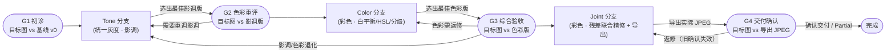
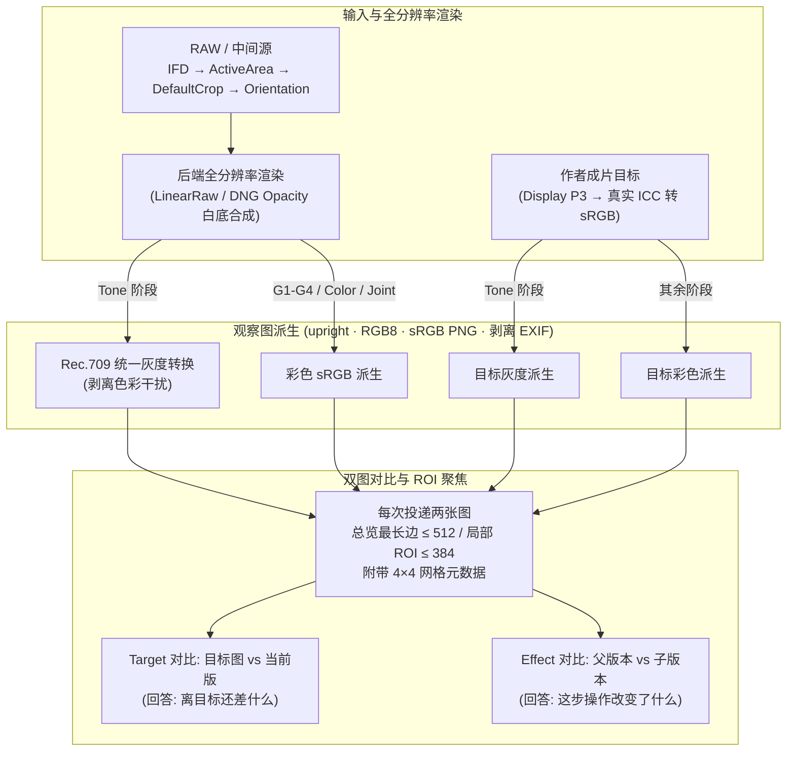
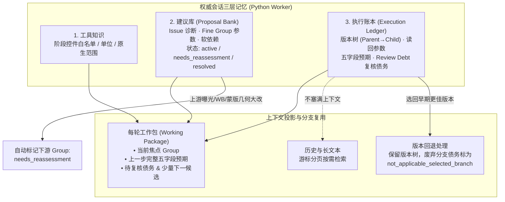
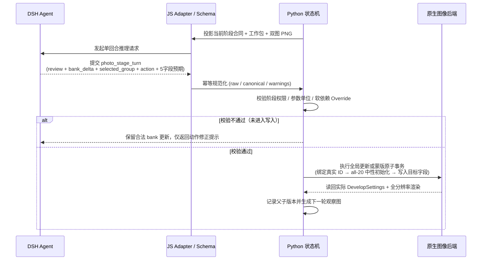

# Retouching Your Long-Horizon Professional Photo Again

RetouchAgain is a domain-specific visual agent harness for long-horizon photo retouching. Built on an external agent runtime, it orchestrates iterative visual assessment, tool execution, state tracking, and verification.

Retouching Your Long-Horizon Professional Photo Again（RetouchAgain）是一个面向**图像后期调色与参考图仿色（Color/Tone Matching）**的多轮视觉 Agent 框架。它将专业修图师的工作流抽象为可验证、可回退的工程闭环：让视觉大模型（DSH Agent）专注于看图对比、诊断问题与参数决策，而由确定性的 Python 状态机负责记忆存储、阶段权限隔离、色彩几何契约以及原生后端的原子执行。

---

## 1. 分级调色闭环与阶段流转

为了避免曝光、白平衡与色彩调整互相耦合干扰，RetouchAgain 采用**“先定影调、再调色彩、最后联合精修”**的三阶段架构，并在各阶段之间设置了 4 个全局检查点（`G1`–`G4`）：



- **可控回退**：任意检查点发现问题均可退回上游分支，G4 返修后必须重新导出并实际观察新 JPEG 才能确认交付。
- **独立结果维度**：流程结束（`complete`）、JPEG 已导出核验、目标部分达成（`partial`）各自独立记录，不把接口调用成功等同于画面达标。

---

## 2. 视觉观察与色彩/几何管线

模型每一轮的判断质量取决于输入图像的色彩与几何一致性。RetouchAgain 在观察层严格区分图像角色、色彩空间与对比类型：



- **Tone 灰度隔离**：Tone 阶段通过统一的非线性/线性亮度公式将对比图转为灰度，确保模型专注影调层次而不被色偏误导。
- **跨图 ROI 资格**：`Effect` 对比在同一画布上直接复用父子 ROI；`Target` 局部对比则分别定位参考 ROI 与源 ROI，结合材质与受光角色确认可比性，并同步检查羽化邻域与区外保护区。

---

## 3. 记忆存储、建议库与复用机制

在长达数十轮的调色过程中，直接把全量历史和菜单塞进上下文会迅速稀释注意力。RetouchAgain 将会话状态拆分为**三层正交记忆**，并通过**工作包投影 + 游标检索**实现高效复用：



- **动态重评而非盲目重放**：当上游曝光、全局白平衡或共享蒙版几何发生显著调整时，下游关联的 HSL 或色彩分级建议会被标记为 `needs_reassessment`，引导模型基于新画面重新计算数值。
- **跨阶段复核债务（Review Debt）**：Tone 引起的色彩偏移会在 G2 结算，Color 对明暗的副作用会在 G3 结算，确保跨阶段修改不留死角。

---

## 4. 任务分配与单回合执行流

RetouchAgain 将调色任务拆解为 **Issue → Branch → Module → Fine Group** 五层结构，并通过**单回合复合提交（`photo_stage_turn`）**驱动闭环，避免无谓的确认轮次：



- **软依赖与灵活路由**：默认路线（如 Tone 先曝光后曲线）仅作为推荐顺序；模型只要给出清晰的 `override_reason`，即可跳过常规顺序优先处理画面瓶颈，或对同一细组进行多轮迭代。
- **蒙版原子事务**：新建 Linear/Radial 蒙版时，宿主会先绑定原生真实 ID 并对全部 20 个局部字段执行中性归零（`amount=100`，其余 19 项置 `0`），彻底消除原生工具的历史滑杆记忆，随后再写入本轮目标字段；跨阶段复用同一物理蒙版时则保留既有参数，只增量更新当前阶段字段。

---

## 5. 示例素材包：`DSC_3734`

仓库内置了一组完整的三角色示例文件（`paired photos/DSC_3734/`，总计 35,225,397 B），用于演示不同图像角色与色彩空间配置：

| 文件 | 角色 | 规格 | 大小 |
|---|---|---|---:|
| [DSC_3734.NEF](<paired photos/DSC_3734/DSC_3734.NEF>) | 原始 RAW 编辑输入 | IFD 8280×5520 | 34,871,808 B |
| [DSC_3734.jpg](<paired photos/DSC_3734/DSC_3734.jpg>) | 作者成片目标 | 512×768, Display P3 | 202,334 B |
| [oDSC_3734.jpg](<paired photos/DSC_3734/oDSC_3734.jpg>) | RAW 基础显影预览 | 512×768, sRGB | 151,255 B |

---

## 6. 文档导航

| 文档 | 内容说明 |
|---|---|
| [系统架构](docs/architecture.md) | 分层架构、G1–G4 检查点、细组组织与单回合复合提交 |
| [工作记忆与任务路由](docs/memory-and-task-routing.md) | 建议库数据结构、状态维度、软依赖 Override 与复核债务 |
| [观察与色彩契约](docs/observation-and-color.md) | 图像角色、ICC 转换、RAW 几何、灰度公式与 ROI 对齐 |
| [操作与蒙版机制](docs/operations-and-masks.md) | 阶段控件白名单、参数单位、Linear/Radial 几何与 all-20 初始化 |
| [通信协议与资源控制](docs/protocol-and-resources.md) | 四层协议、64K 配额、50 步编排模板、四维计数与授权周期 |
| [环境搭建与运行范围](docs/scope-and-environment.md) | 外部依赖说明、环境变量配置与离线合成测试入口 |
| [导出与同步指南](docs/manual-sync.md) | 维护者导出筛选、静态检查与 Git 推送流程 |

---

## 7. 核心源码与离线测试

### 主要模块入口
- `src/dsh_stage_run.mjs`：主循环运行入口，串联 DSH Agent 与阶段状态机。
- `src/dsh_stage_adapter.mjs`：模型请求封装、Schema 动态校验与回执诊断。
- `src/dsh_stage_worker.py`：核心状态机，管理阶段流转、版本树、建议库与执行账本。
- `src/photo_stage_tasks.py` / `src/photo_proposal_bank.py`：任务注册、软依赖解析与工作包构建。
- `src/photo_stage_schema.py` / `src/photo_stage_operations.py`：动态提交合同与蒙版原子事务。
- `src/photo_stage_observation.py` / `src/photo_image_contract.py` / `src/raw_render_contract.py`：色彩、ICC、RAW 几何与灰度观察图派生。

### 运行离线合成测试
在安装 `Pillow` 和 `NumPy` 后，可直接运行以下 5 个脚本验证核心状态机、操作权限与调度逻辑（使用合成夹具，无需外部模型或原生后端）：

```bash
python -I -B -X utf8 src/check_photo_stage_tasks.py
python -I -B -X utf8 src/check_photo_stage_operations.py
python -I -B -X utf8 src/check_photo_stage_schema.py
python -I -B -X utf8 src/check_photo_phase_workflow.py
python -I -B -X utf8 src/check_photo_stage_continuation.py
```

详细依赖与环境变量（`VISHARNESS_PYTHON`、`VISHARNESS_FULL_AUTHOR_ROOT`、`VISHARNESS_DNG_CONVERTER`）配置请参见 [环境搭建与运行范围](docs/scope-and-environment.md)，完整文件清单见 [publication-scope.json](publication-scope.json)。
