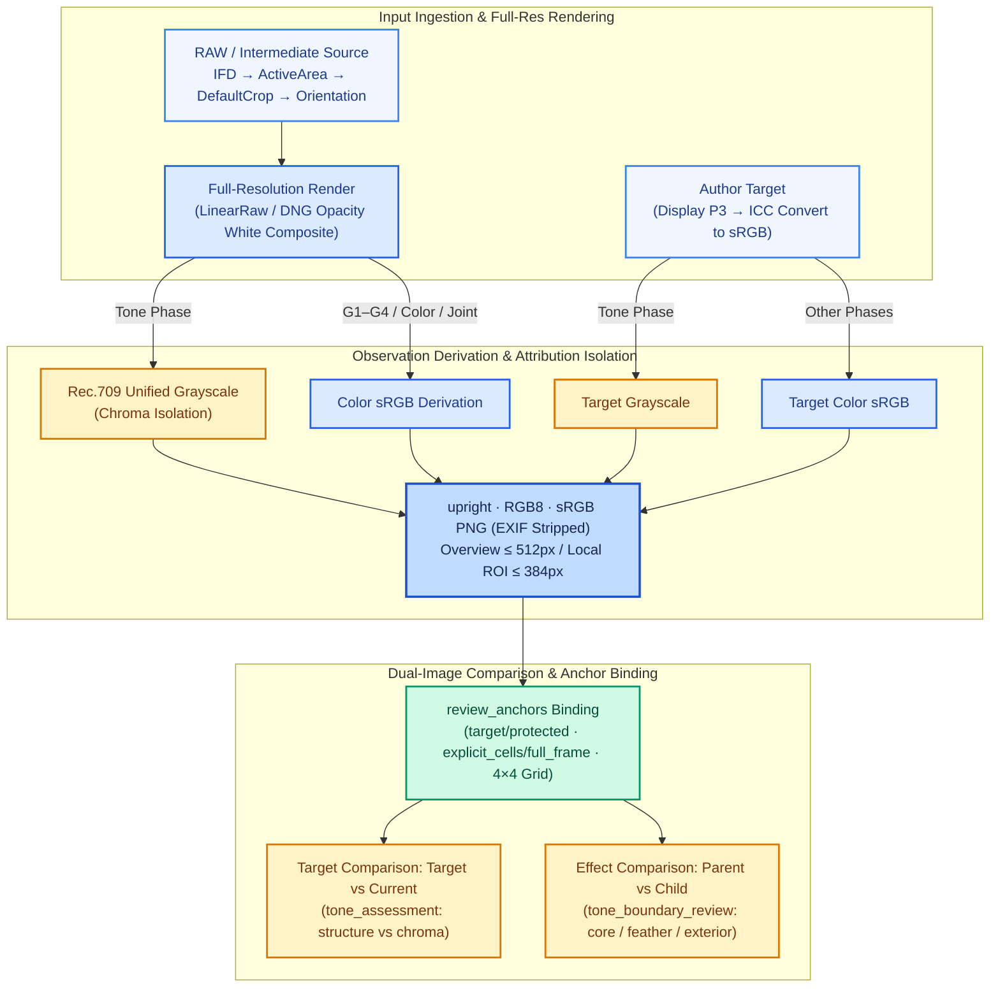
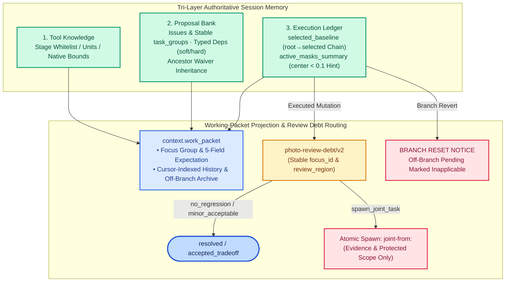

# Retouching Your Long-Horizon Professional Photo Again

**RetouchAgain** is a domain-specific **visual agent harness** for long-horizon professional photo retouching. Built on an external agent runtime, it decouples high-level visual reasoning from deterministic state governance, perceptual observation contracts, and atomic native execution.

---

## Introduction

Professional RAW photo retouching and reference-based color/tone matching constitute a **long-horizon, non-commutative, and tightly coupled** sequential decision-making problem. Adjusting global exposure simultaneously shifts perceived contrast, highlight roll-off, and chromatic saturation; dozens of continuous sliders, tone curves, and local masks interact across editing stages, causing early misjudgments to compound along the edit trajectory. Existing approaches struggle at both ends of the spectrum: **feed-forward neural retouching models** (e.g., single-shot LUT or pixel-level filters) lack non-destructive native editability and iterative self-correction, while **unconstrained VLM tool-calling** over raw editing APIs suffers from long-horizon context dilution, cross-stage parameter interference, sticky native tool states, and ungrounded parameter guessing without verifying rendered outcomes.

We argue that reliable long-horizon visual retouching is fundamentally a **harness engineering** problem rather than a single-turn prompting or end-to-end weight-fitting problem. Instead of training a task-specific pixel predictor or modifying the underlying foundation model, **RetouchAgain (VisHarness v20)** introduces a deterministic, domain-specific **visual agent harness** between a multimodal reasoning agent (DSH) and a native imaging backend. The agent focuses exclusively on visual comparison, discrepancy attribution, and parameter selection, while the harness enforces perceptual consistency, memory convergence, and atomic execution boundaries.

Specifically, the RetouchAgain harness is built around four tightly integrated mechanisms:
- **Phase-Gated Workflow & Attribution Isolation**: Global checkpoints (`G1–G4`) partition editing into `Tone` (Rec.709 unified grayscale, *Neutral-First* ordering, and optional `pre_tone_wb`), `Color` (contextual `wb_assessment` and `develop.wbPick`), and `Joint` residual refinement, decoupling luminance structure (`structure`) from chromatic appearance (`chroma`) with full backtracking support.
- **Perceptual & Color-Geometry Observation Contract**: A deterministic rendering pipeline enforces `IFD → ActiveArea → DefaultCrop → Orientation` geometry normalization, ICC-to-sRGB color conversion, and full-resolution rendering before downsampling, while `review_anchors` bind `Target` (goal gap) and `Effect` (step outcome) comparisons directly to verified image regions and 4×4 grid metadata.
- **Tri-Layer Memory Topology & Cross-Phase Review Debt**: Session state is separated into *Tool Knowledge*, a *Proposal Bank* (supporting typed `soft/hard` dependencies and ancestor-chain waiver inheritance), and an *Execution Ledger* (`selected_baseline` version tree and `active_masks_summary`). Each turn projects only a focused `context.work_packet` to prevent context drift, while `photo-review-debt/v2` and atomic `spawn_joint_task` track cross-stage side effects.
- **Execution Fence & Resumable Close Proofs**: All native mutations pass through a persistent execution fence that enforces `all-20` neutral initialization on newly created Linear/Radial masks and exact stage-scoped patching on same-ID reuse. Verifiable `close_proof` reconstruction and checkpoint continuation enable lossless recovery across interrupted sessions.

---

## 1. 分级调色闭环与阶段流转（v20）

为消除曝光、白平衡与色彩调整之间的耦合干扰，Harness 采用**“先定影调、再调色彩、最后联合精修”**的三阶段架构，并在节点之间设置 4 个全局检查点（`G1`–`G4`）。v20 在 `G1` 与 `Tone` 之间新增了可选的一次性前置粗白平衡（`pre_tone_wb`）及局部边界复核机制：


- **Neutral-First 影调路线**：Tone 阶段推荐 `whites_blacks → exposure → highlights_shadows → contrast → master_curve → parametric_curve → local_tone → closure`，先立黑白锚点与中灰骨架，再做局部光影。
- **可控回退与独立维度**：任意检查点均可退回上游分支（G4 返修后需重新导出并观察新 JPEG）；流程完结（`complete`）、JPEG 核验与目标部分达成（`partial`）各自独立记录。

---

## 2. 视觉观察、归因隔离与色彩/几何管线

模型每一轮的判断精度取决于输入图像的色彩、几何与对比语境。Harness 在观察层严格规范图像角色、色彩空间转换与物理/色彩归因分离（`tone_assessment`）：



- **归因隔离（`structure` vs `chroma`）**：G1 与 Tone 阶段显式区分“真实影调结构差距”和“由色度/饱和度引起的明暗观感差异”，把后者留给 HSL-L 或色彩分支处理。
- **语境化白平衡（`wb_assessment`）**：G2 区分 `target_intent`（中性参考 vs 作者刻意氛围 `intentional_cast`）与 `atmosphere.route`（交由 `grading` 或 `local_wb`），避免机械消色偏。

---

## 3. 记忆拓扑、工作包复用与 `photo-review-debt/v2`

为防止长程多轮对话稀释注意力，Harness 将会话状态拆分为**三层正交记忆**，并在 v20 引入 **`active_masks_summary`**、**`selected_baseline` 真实链**与 **逐焦点复核债务（`photo-review-debt/v2`）**：



- **Typed 依赖与 Waiver 继承**：支持 `soft / hard`、`disposition / effect` 精确依赖约束；`soft skip / retire` 的豁免记录可沿选中祖先链自动继承。
- **跨阶段复核债务**：Tone 引起的色彩/边界问题进入 G2 债务，Color 的 WB 与 HSL-L 亮度副作用进入 G3 债务；发现跨阶段问题可通过 `spawn_joint_task` 原子派生 Joint 精修任务。

---

## 4. 任务分配、原子事务与单回合执行流

Harness 将调色任务拆解为 **Issue → Branch → Module → Fine Group**，并通过单回合 `photo_stage_turn` 完成“复核 → 更新建议库 → 选组 → 执行”闭环，同时提供**闭合证明（`close_proof`）与检查点续接（`continuation`）**：

```mermaid
sequenceDiagram
    autonumber
    box rgba(237, 233, 254, 0.5) Decision & Adaptation Layer
        participant Agent as DSH Agent
        participant Adapter as JS Adapter / Schema
    end
    box rgba(209, 250, 229, 0.5) Harness State Machine
        participant Worker as Python Worker (v20)
    end
    box rgba(239, 246, 255, 0.7) Execution Backend
        participant Native as Native Imaging Backend
    end

    Worker->>Adapter: Project Stage Contract + context.work_packet + Dual PNGs
    Adapter->>Agent: Dispatch Single-Turn Reasoning Request
    Agent-->>Adapter: Submit photo_stage_turn<br/>(review / anchors / bank_delta / selected_group / action)

    rect rgba(254, 243, 199, 0.45)
        Note over Adapter,Worker: Idempotent Normalization & Fault Isolation
        Adapter->>Worker: Preserve raw/canonical/warnings (unknown anchor fallback / alias norm)
        Worker->>Worker: Validate Stage Scope, Typed Deps & Debt Batch Isolation
    end

    alt Validation Rejected (no-effect before native write)
        Worker-->>Agent: Retain Valid Bank Updates & Return Action Correction Feedback
    else Passed Execution Fence
        rect rgba(255, 228, 230, 0.45)
            Note over Worker,Native: Atomic Native Transaction & Same-ID Mask Reuse
            Worker->>Native: Global Patch / develop.wbPick / Mask Transaction<br/>(Create: Bind Real ID → all-20 Init; Reuse: Stage-Scoped Patch)
            Native-->>Worker: Readback DevelopSettings + Full-Res Render
        end
        Worker->>Worker: Update Version Tree, close_proof & Next Observation Pair
    end
```

- **同 ID 局部蒙版复用（v19–v20）**：复用既有 `mask ID` 时仅 patch 当前阶段字段（Tone 6 项、Color `Temp/Tint`、Joint 8 项），保留已有参数与几何；当 `typed action` 明确指向唯一现存 `mask ID` 或空列表新建时，自动兼容跳过冗余表单阻塞。

---

## 5. 示例素材包：`DSC_3734`

仓库内置了一组完整的三角色示例文件（`paired photos/DSC_3734/`，总计 35,225,397 B），用于演示不同图像角色与色彩空间配置：

| 文件 | 角色 | 规格 | 大小 |
|---|---|---|---:|
| [DSC_3734.NEF](<paired photos/DSC_3734/DSC_3734.NEF>) | 原始 RAW 编辑输入 | IFD 8280×5520 | 34,871,808 B |
| [DSC_3734.jpg](<paired photos/DSC_3734/DSC_3734.jpg>) | 作者成片目标 | 512×768, Display P3 | 202,334 B |
| [oDSC_3734.jpg](<paired photos/DSC_3734/oDSC_3734.jpg>) | RAW 基础显影预览 | 512×768, sRGB | 151,255 B |

---

## 6. 文档导航

| 文档 | 内容说明 |
|---|---|
| [系统架构](docs/architecture.md) | 分层架构、G1–G4 检查点、细组组织与单回合复合提交 |
| [工作记忆与任务路由](docs/memory-and-task-routing.md) | 建议库数据结构、状态维度、软依赖 Override 与复核债务 |
| [记忆拓扑与区域复核（v20）](docs/memory-review-v20.md) | Typed 依赖、活跃蒙版链、`photo-review-debt/v2` 与提交容错 |
| [Tone 阶段机制（v20）](docs/tone-guidance-v20.md) | 差距归因隔离、Neutral-First 路线、`pre_tone_wb` 与边界交接 |
| [白平衡机制（v20）](docs/white-balance-v20.md) | `wb_assessment` 语境诊断、`develop.wbPick` 与同 ID 局部复用 |
| [观察与色彩契约](docs/observation-and-color.md) | 图像角色、ICC 转换、RAW 几何、灰度公式与 ROI 对齐 |
| [操作与蒙版机制](docs/operations-and-masks.md) | 阶段控件白名单、参数单位、Linear/Radial 几何与 all-20 初始化 |
| [通信协议与资源控制](docs/protocol-and-resources.md) | 四层协议、64K 配额、50 步编排模板、四维计数与授权周期 |
| [v20 版本与运行说明](docs/v20-update-and-usage.md) | `dsh-stage-runtime-v20` 标识、闭合证明、检查点续接与新增测试 |
| [环境搭建与运行范围](docs/scope-and-environment.md) | 外部依赖说明、环境变量配置与离线合成测试入口 |
| [导出与同步指南](docs/manual-sync.md) | 维护者导出筛选、静态检查与 Git 推送流程 |

---

## 7. 核心源码与离线测试

### 主要模块入口
- `src/dsh_stage_run.mjs` / `src/dsh_stage_adapter.mjs`：主循环运行入口、Schema 动态校验与回执诊断。
- `src/dsh_stage_worker.py`：核心状态机，管理阶段流转、版本树、建议库与执行账本。
- `src/photo_stage_tasks.py` / `src/photo_proposal_bank.py` / `src/photo_working_context.py`：任务注册、Typed 依赖、活跃蒙版摘要与工作包构建。
- `src/photo_review_anchors.py` / `src/photo_phase_scheduler.py`：区域锚点绑定与 `photo-review-debt/v2` 跨阶段债务调度。
- `src/photo_tone_guidance.py` / `src/photo_pre_tone.py` / `src/photo_white_balance.py`：Tone 归因引导、`pre_tone_wb` 与白平衡诊断复用。
- `src/photo_stage_schema.py` / `src/photo_stage_operations.py`：动态提交合同与蒙版原子事务。
- `src/photo_stage_close_proof.py` / `src/photo_stage_continuation.py`：闭合证明重建与检查点无缝续接。
- `src/photo_stage_observation.py` / `src/photo_image_contract.py` / `src/raw_render_contract.py`：色彩、ICC、RAW 几何与灰度观察图派生。

### 运行离线合成测试
在安装 `Pillow` 和 `NumPy` 后，可直接运行以下 **11 个离线合成测试脚本**验证核心状态机、v20 引导机制、闭合证明与调度逻辑（使用合成夹具，无需外部模型或原生后端）：

```bash
python -I -B -X utf8 src/check_photo_working_context.py
python -I -B -X utf8 src/check_photo_review_anchors.py
python -I -B -X utf8 src/check_photo_tone_guidance.py
python -I -B -X utf8 src/check_photo_white_balance.py
python -I -B -X utf8 src/check_photo_stage_tasks.py
python -I -B -X utf8 src/check_photo_stage_operations.py
python -I -B -X utf8 src/check_photo_stage_schema.py
python -I -B -X utf8 src/check_photo_phase_workflow.py
python -I -B -X utf8 src/check_photo_stage_continuation.py
python -I -B -X utf8 src/check_dsh_stage_phase_worker_synthetic.py
python -I -B -X utf8 src/check_photo_stage_close_proof_synthetic.py
```

详细依赖与环境变量（`VISHARNESS_PYTHON`、`VISHARNESS_FULL_AUTHOR_ROOT`、`VISHARNESS_DNG_CONVERTER`）配置请参见 [环境搭建与运行范围](docs/scope-and-environment.md)，完整文件清单见 [publication-scope.json](publication-scope.json)。
