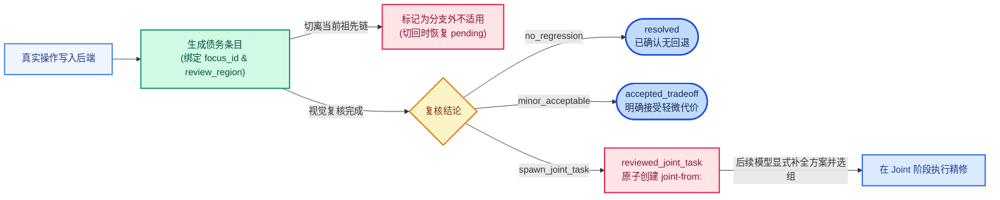

# 记忆拓扑、区域复核与实际引用（v20）

本文档介绍 v20 在建议库依赖建模、活跃蒙版上下文投影、`photo-review-debt/v2` 逐焦点复核债务，以及 v18–v20 提交容错上的机制设计。

## 1. 建议库与 Typed 依赖模型

系统只维护一份权威建议库：`issue` 保存完整诊断与修订历史，`task_groups` 是其派生出的可执行细组。每轮必须显式选定 `issue / group` 才可触发动作，跳过或结案均通过状态位精确表达：

- **跳过与重开**：组级 `skip` 记为 `skipped`（可通过显式 `revise` 重新激活）；`retire` 仅停用该建议，不会自动回滚此前已写入的后端参数。
- **Typed 依赖约束**：除兼容旧版字符串软依赖外，v20 支持使用 `typed` 依赖对象精确指定 `soft / hard`、`disposition / effect` 以及关联的 `operation`：
  - `hard disposition`：要求目标组在当前适用分支下已达到 `resolved`。
  - `effect` 依赖：要求当前祖先链上存在真实执行操作及对应的效果判断。
- **Waiver 继承**：`soft skip / retire` 的豁免（waiver）绑定到具体处置记录，并可沿选中祖先链向下继承，避免在每个子版本重复确认。

## 2. 活跃蒙版摘要与版本链上下文

- **活跃蒙版摘要（`active_masks_summary`）**：在全阶段区分 `selected` 与 `observed`，完整保留隐藏、零值或复杂蒙版身份。当同类型蒙版中心距严格小于 `0.1` 时，系统输出轻量几何提醒辅助模型判断（不阻断执行）。Linear 蒙版中点独立于覆盖中心，Radial 半径按图像长边比例定义。
- **基线链与投影折叠**：`selected_baseline` 提供 `root → selected` 真实版本链、实际变更控件及 `inactive` 引用；跨分支选版时自动记录 `BRANCH RESET NOTICE`。顶层 `context.work_packet` 为唯一工作包正文，历史操作参数与废弃分支正文折叠为可按游标检索的索引，未复核预期始终完整保留。

## 3. 区域锚点与逐 Focus 复核债务（`photo-review-debt/v2`）

`review.review_anchors` 分别记录 `target / protected`、`explicit_cells / full_frame / unknown`、`view_role`、`region` 与 `qualification`，直接绑定到真实的观察图、版本、阶段、ROI 与网格。

`photo-review-debt/v2` 为同一真实操作维护一条债务及稳定的 `focus_id`，包含 `outcome`、`evidence`、`review_region` 与实际 `review_cells`，其状态流转如下：

- **原子派生 Joint 任务**：`spawn_joint_task` 会以原子、幂等方式创建 `joint-from:<debt_id>` 诊断节点（初始 `groups: []`），仅承载视觉证据与保护区域关系，后续由模型显式补充参数方案后再执行。

## 4. v18–v20 提交容错与规范化

为减少格式细节对正常调色流程的阻塞，v18–v20 在入参规范化层增加了确定性兼容处理：
- **可选 Anchor 容错**：无法绑定的 `role / cell` 保留原始提交与 `warning`，定位自动回落为明确的 `unknown focus`。
- **债务批次与动作分流**：时机不适用或不合格的附带 `debt batch` 记为 `not_adopted_debts_unchanged`（原债务保持不变），同回合内其他合法 `action` 仍正常校验执行；被采纳批次的债务更新与 Joint 派生保持事务原子性。
- **稳定 Group ID**：完整 `group ID` 自动去重前缀，修订遗漏旧组时维持原状态；对已 `retired` 对象的重复 `keep / retire` 仅记录审计日志。
- **Operation 与 Expectation 别名归一**：当当前观察版存在唯一的 `operation → expectation` 映射时，自动规范化别名并留存 `warning`；针对已复核操作的冗余 `effect` 声明仅归档留存，不覆盖既有判断。

## 5. 代码入口

- 核心实现：[`photo_proposal_bank.py`](../src/photo_proposal_bank.py)、[`photo_stage_tasks.py`](../src/photo_stage_tasks.py)、[`photo_working_context.py`](../src/photo_working_context.py)、[`photo_review_anchors.py`](../src/photo_review_anchors.py)、[`photo_phase_scheduler.py`](../src/photo_phase_scheduler.py)、[`dsh_stage_worker.py`](../src/dsh_stage_worker.py)。
- 离线检查：[`check_photo_working_context.py`](../src/check_photo_working_context.py)、[`check_photo_review_anchors.py`](../src/check_photo_review_anchors.py)。
- 相关专题：[白平衡机制](white-balance-v20.md)、[Tone 阶段机制](tone-guidance-v20.md)、[v20 版本与运行说明](v20-update-and-usage.md)。
