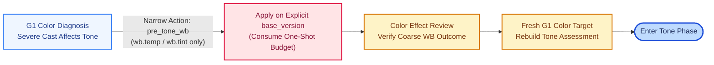

# Tone：归因隔离、Neutral-First 路线与边界交接（v20）

本文档说明 v20 在 Tone 阶段的差距归因分类、Neutral-First 推荐调色顺序、可选前置粗白平衡（`pre_tone_wb`）以及局部边界交接机制。

## 1. G1 差距归因与权限解耦

G1 彩色初诊阶段可以提出覆盖后续所有阶段（包括 Color 与 Joint）的诊断与参数建议，由 Harness 按 `issue / branch / module / fine group` 分类存入建议库；建议存储与实际执行权限解耦，提前规划颜色方案不会越权触发编辑。

模型通过 `review.tone_assessment` 记录参考/当前区域、材质、受光、保护目标与 handoff，并对明暗差距给出明确归因（`attribution`）：
- **`structure`**：真实的影调结构与反差差距，留在 Tone 阶段解决。
- **`chroma`**：由色彩饱和度或色相明度引起的观感明暗差异，交由后续 HSL-L 或色彩分支处理。
- **`uncertain`**：暂不确定，可随后续真实观察修订。

Tone 阶段在观察层统一执行 sRGB 解码 → `Y = 0.2126R + 0.7152G + 0.0722B` → 灰度 sRGB 编码并同步至三通道，保证双图亮度对比一致且不改变后端彩色母版。

## 2. Neutral-First 推荐路线与曲线约束

v15 起，Tone 阶段采用 **Neutral-First** 推荐顺序，优先建立黑白端支撑与中灰骨架：

```text
whites_blacks → exposure → highlights_shadows → contrast → master_curve → parametric_curve → local_tone → closure
```

该路线作为默认排序提示，模型可根据实际画面瓶颈灵活调整优先级、跳过无关模块或对同一细组多轮微调。Tone 阶段的 Master 点曲线支持 `[]` 重置，或 `2–5` 个控制点（`x` 严格递增、`y` 单调不减），统一映射 `settings.curve.master` 与 `develop.curve`。

## 3. 可选的一次性前置粗 WB（`pre_tone_wb`）

当源图存在严重偏色、直接影响影调基准判断时，模型可在 G1 阶段选择触发一次性的窄动作 `pre_tone_wb`：



- **动作约束**：必须显式指定 `base_version`，仅开放 `wb.temp / wb.tint` 标量（至少一项），并附带 `tone_basis_impact` 与预期说明。
- **一次资格管理**：资格仅在实际执行成功后消耗（校验失败未写入时不消耗，`reload`、选父版或检查点续接均保留已消耗状态）。默认无严重偏色时直接跳过此步进入 Tone。

## 4. 局部边界复核与跨阶段交接

Tone 局部蒙版除了评估目标区域外，还通过 `review.tone_boundary_review` 复核保护边界、羽化邻域与区外区域的受影响状态（`protected` / `affected` / `uncertain`）：
- **细边界交接**：Tone 遗留的细边界残差可直接转交同一 Issue 下的 Joint 细组处理，无需重复新建蒙版。
- **跨阶段债务**：Tone 导致的色彩或边界副作用进入 G2 复核债务；Color 阶段实际修改 HSL-L 带来的明暗变化则进入 G3 复核债务。

## 5. 提交格式兼容

v18 起，规范化层支持将指定叙述字段中的 `string list` 做可逆 JSON 文本整理，保留允许的附带叙述、排序提示与重复模块声明（附带 `warning`），并规范化 Light 家族组织别名，具体参数写入仍严格以 `typed action` 为准。

## 6. 代码入口

- [`photo_tone_guidance.py`](../src/photo_tone_guidance.py)：归因分类、边界复核与 HSL-L 差异追踪。
- [`photo_pre_tone.py`](../src/photo_pre_tone.py)：`pre_tone_wb` 资格控制、后果复核与续接校验。
- [`photo_stage_submission.py`](../src/photo_stage_submission.py)：提交结构规范化。
- [`check_photo_tone_guidance.py`](../src/check_photo_tone_guidance.py)：离线合成检查脚本。

相关文档：[白平衡机制](white-balance-v20.md)、[记忆与区域复核](memory-review-v20.md)、[v20 版本与运行说明](v20-update-and-usage.md)。
