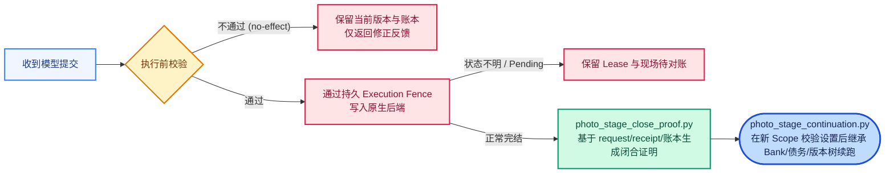

# v20 版本说明、运行前提与测试入口

本文档汇总 v20 版本的协议标识、专题文档索引、闭合续接机制以及新增的离线合成测试入口。

## 1. 版本标识与专题索引

- **当前构建**：`dsh-stage-runtime-v20-20261114`（资源配置 `stage-resource/v20`，外层协议 `dsh-stage-runtime/v2`，动态阶段合同 `stage-contract/v3`）。
- **v20 新增专题文档**：
  - [白平衡机制（`white-balance-v20.md`）](white-balance-v20.md)：语境化 WB 诊断、原生采样与局部蒙版无缝复用。
  - [Tone 阶段机制（`tone-guidance-v20.md`）](tone-guidance-v20.md)：差距归因隔离、Neutral-First 路线与 `pre_tone_wb`。
  - [记忆与区域复核（`memory-review-v20.md`）](memory-review-v20.md)：Typed 依赖、活跃蒙版链、`photo-review-debt/v2` 与提交容错。

## 2. 运行入口与环境准备

- **正式运行入口**：[`src/dsh_stage_run.mjs`](../src/dsh_stage_run.mjs)。
- **环境依赖**：Python 环境需安装 `Pillow`、`NumPy`（特殊格式按需安装 `tifffile` / `imagecodecs`），并接入兼容的 DSH 运行时、原生图像编辑器后端及 DNG 转换工具。
- **路径环境变量**：
  - `VISHARNESS_PYTHON`：指定 Python 解释器路径。
  - `VISHARNESS_DNG_CONVERTER`：指定 DNG 转换器路径。
  - `VISHARNESS_FULL_AUTHOR_ROOT`：显式读取原尺寸作者目标图时的根目录（默认流程使用短边 512 副本）。

## 3. 执行护栏、闭合证明与检查点续接

为确保长程多轮会话在中断、重试或升级后状态一致，v20 完善了执行前隔离与检查点续接机制：



- **闭合证明（[`photo_stage_close_proof.py`](../src/photo_stage_close_proof.py)）**：从实际请求、回执、工作流提交、原生账本与关闭记录重建闭合证明；当动作已结清且无活动标记时，可作为新 scope 的可靠续接依据。
- **检查点续接（[`photo_stage_continuation.py`](../src/photo_stage_continuation.py)）**：在新 scope 中校验实际选中设置与文件来源链后，直接继承已有建议库、复核债务、版本树及一次性资格记录，跳过已完成动作与基线渲染。

## 4. 离线合成测试入口

完整测试清单以 [`publication-scope.json`](../publication-scope.json) 的 `synthetic_test_entrypoints` 为准。除原有 5 个核心测试外，v20 新增覆盖白平衡、Tone 引导、工作上下文、区域锚点以及状态机/闭合证明的独立合成测试：

```bash
python -I -B -X utf8 src/check_photo_working_context.py
python -I -B -X utf8 src/check_photo_review_anchors.py
python -I -B -X utf8 src/check_photo_tone_guidance.py
python -I -B -X utf8 src/check_photo_white_balance.py
python -I -B -X utf8 src/check_dsh_stage_phase_worker_synthetic.py
python -I -B -X utf8 src/check_photo_stage_close_proof_synthetic.py
```

## 5. 资源配额与同步维护

- **资源配置**：默认生成配额为 `65,536` tokens，工作上下文参考区间为 `32–64K`（宽容上限 `128K`），全流程以 `50` 次观察作为编排规划参考。
- **手动维护**：所有文档与源码同步均通过本地导出检查后手动提交至 GitHub，确保代码、清单与文档版本保持一致。
