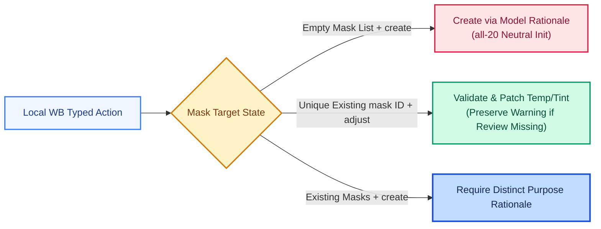

# 白平衡：视觉基准、局部复用与跨阶段复核（v20）

本文档说明 v20 在白平衡诊断分类、原生采样读回、局部蒙版无缝复用以及跨阶段影调耦合复核上的实现细节。

## 1. 语境化的白平衡诊断（`review.wb_assessment`）

进入 G2 后，模型在真实彩色图像上重新评估色彩关系，并通过 `review.wb_assessment` 将白平衡判断拆分为三个独立维度，避免“见色就归中性”：

- **`reference_status`（`available` / `not_available`）**：存在可靠中性参照时，记录 1–2 组独立的作者/当前网格坐标、材质、受光条件、`neutrality_basis` 及冷暖/绿品红残差；画面缺乏可靠中性物时允许 `reference_pairs` 为空。
- **`target_intent`（`neutral` / `intentional_cast` / `uncertain`）**：结合 `intent_reason` 区分需要消除的技术性偏色与作者刻意营造的氛围色调、材质固有色或环境反光。
- **`wb_task_status`（`needed` / `not_needed` / `uncertain`）**：明确判断当前是否需要调整白平衡，无需修改时可直接跳过。

对于高光/暗部的局部氛围或空间分离的偏色，可通过 `atmosphere.route`（`grading` / `local_wb` / `none` / `uncertain`）显式分流至色彩分级或局部白平衡处理。

## 2. 实际读回、软步长参考与原生采样（`develop.wbPick`）

工作包会向模型提供后端读回的真实 WB `mode`、`scale`、`temp`、`tint`：
- **软步长参考**：对于已确认 Kelvin 标度且基线在 `5000K` 左右的场景，参考以 `150–250K` 作微调量级、`500K+` 配合明确依据作大幅调整，Tint 参考 `3–6` 步长；所有提交均以绝对数值写入。
- **原生白平衡采样（`develop.wbPick`）**：在 Color 或 Joint 阶段且控件可用时，模型可对具有物理中性依据的区域发起采样（使用完整定向源坐标，底层对定向 `SourceLevel::Thumb` 取 `5×5` 邻域）。宿主会校验返回值、有效 `scale` 以及非 WB 参数未发生意外变动。

## 3. 同一实际蒙版的精确 Patch 与 v19–v20 兼容

Tone 局部开放 6 项影调字段，Color 局部开放 `Temp / Tint`，Joint 开放全部 8 项。复用同一物理 `mask ID` 时，系统仅对本阶段字段执行精确 patch，完整保留该蒙版上既有的影调、几何、可见性与反相状态。新建蒙版则绑定原生返回的真实 ID 并先执行 `all-20` 中性初始化。

## 4. 结案依据与 G3 债务联动

- **Target 结案**：将白平衡问题标记为 `resolved` 时需具备适用的 `target` 对比依据（支持直接复用同阶段同版本下已记录的有效 `target` 依据）；后续出现新视觉证据时仍可显式 `revise`。
- **跨阶段关注点**：Color 阶段发生的实际 WB 数值、模式或局部 WB 变更，会自动在原同条 G3 复核债务上追加区域影调与边界关注点，确保进入 Joint 前完成联动检查。

## 5. 代码入口

- [`photo_white_balance.py`](../src/photo_white_balance.py)：白平衡 assessment、局部复用、读回上下文与耦合追踪。
- [`dsh_stage_worker.py`](../src/dsh_stage_worker.py)：合同校验与显式 ID 兼容接线。
- [`photo_stage_operations.py`](../src/photo_stage_operations.py)：阶段控件权限与蒙版事务。
- [`check_photo_white_balance.py`](../src/check_photo_white_balance.py)：离线合成检查脚本。

相关文档：[Tone 阶段机制](tone-guidance-v20.md)、[记忆与区域复核](memory-review-v20.md)、[v20 版本与运行说明](v20-update-and-usage.md)。
